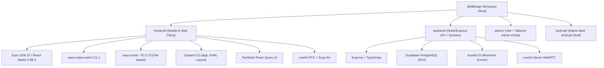
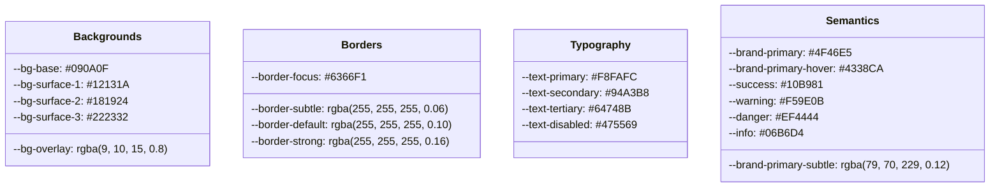
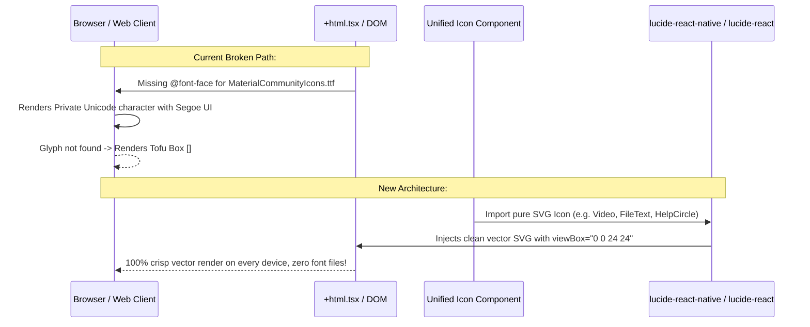
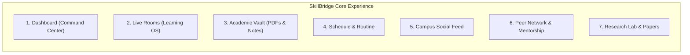

# SkillBridge: UI/UX & Frontend Architecture Audit and Master Redesign Blueprint

> **Role**: Principal UI/UX Architect & Senior Frontend Design Engineer  
> **Target Application**: SkillBridge (Campus Peer-to-Peer Academic & Skill Exchange Platform)  
> **Status**: Comprehensive Architectural Audit & Strategic Blueprint  
> **Codebase Analyzed**: Monorepo (`frontend/`, `backend/`, `admin/`, `android/`)

---

## Executive Summary

SkillBridge possesses a powerful backend and feature engine—spanning real-time WebRTC audio/video rooms (LiveKit), an offline-first academic vault, routine extraction, peer mentorship bookings, social networking, student clubs, and gamified streak analytics.

However, the existing web user experience suffers from severe presentation, architectural, and design system defects. As evidenced by the production dashboard screenshot, the interface is plagued by:
1. **Broken Font-Glyph Icons Rendering as Missing Tofu Boxes (`[]`)** across all primary actions, top navigation, streak badges, and headers.
2. **A "Border Soup" Aesthetic** with hyper-saturated, competing neon accent colors (cyber yellow, fiery orange, emerald green, royal blue, and violet) clashing in a single viewport.
3. **A Rigid, Unbalanced Three-Column Layout** that squeezes primary learning content while permanently locking sidebars without an icon-only collapsed rail mode.
4. **Weak Typographic Hierarchy and Inconsistent Spacing**, relying on random font sizes (8px to 32px), heavy `fontWeight: 800/900` across body elements, and hardcoded inline pixel margins.

This blueprint delivers a **production-grade architectural audit** and an **executable transformation plan** inspired by the refined craft of **Linear**, **Notion**, **Vercel**, and **Raycast**, tailored to a high-density, modern university campus platform.

---

## 1. Existing Architecture Analysis

### 1.1 Technology Stack & Monorepo Topology



| Area | Implementation in Codebase | Assessment & Technical Details |
| :--- | :--- | :--- |
| **Frontend Framework** | React 19.2.3, React Native 0.86.2, Expo SDK ~57.0.15 | Bleeding-edge React 19 with Expo Router v57 file-based routing. Cross-compiles to Native Android/iOS and Web via `react-native-web` 0.21.2. |
| **Routing System** | `expo-router` file-based routing (`frontend/app/`) | Fully configured with route groups `(auth)`, `(tabs)`, dynamic routes (`room/[id]`, `vault`, `schedule`, `chat/[id]`), and root layout `app/_layout.tsx`. |
| **Web Layout Shell** | `src/components/navigation/WebResponsiveShell.tsx` | Conditionally mounts for `Platform.OS === 'web'`. Injects `WebHeader`, `WebLeftSidebar`, `WebRightSidebar`, and `WebFloatingToolbar`. |
| **Styling Strategy** | Hybrid: RN `StyleSheet` + Inline Styles + Raw CSS in `+html.tsx` | Fragmented styling. `theme/index.ts` provides palette generation, but components frequently bypass tokens with hardcoded hex colors and arbitrary pixel values. |
| **Icon Strategy** | `@expo/vector-icons` (`MaterialCommunityIcons`, `Ionicons`) | **Critical failure on Web**: Relies on TrueType font glyphs (`.ttf`). No `@font-face` declaration or font asset preloading in `+html.tsx` or `_layout.tsx`, causing universal tofu box `[]` rendering. |
| **State Management** | Zustand 5 (`useAppStore`, `usePreferencesStore`, `useWebLayoutStore`) | Clean separation of persistent preferences (AsyncStorage) and transient UI layout state. Missing collapsed-sidebar state. |
| **Data Fetching & Cache** | `@tanstack/react-query` v5 (`QueryClientProvider`) | Robust cache invalidation on socket events (`notification:new`, `chat:message`). Healthy default stale times (15s–60s). |
| **Backend Integration** | REST (`/api/v1`) via `src/lib/api.ts` + Supabase JS + Socket.IO | High backend fidelity with 30+ well-structured routes (`dashboard`, `rooms`, `vault`, `calendar`, `connections`, `gamification`, `chat`). |

### 1.2 Route and Page Inventory

The frontend contains **90+ routes and features** that rely on the application shell:

1. **Academic Command Core**:
   - `/(tabs)/index.tsx`: Main Academic Command Center / Dashboard (renders `WebHomeBentoGrid` or widget stack).
   - `/feed.tsx`: Campus Social & Academic Feed with 9 filter categories (polls, questions, achievements, code snippets).
   - `/vault.tsx` & `/pdf-reader.tsx`: Offline-first Academic Vault (curated PDFs, exam routines, syllabus notes).
   - `/schedule.tsx` & `/calendar/*`: Unified Routine & Class Conflict Detector.
2. **Collaborative Learning**:
   - `/(tabs)/rooms.tsx`: Study Room Directory (filter by live, scheduled, campus, topic).
   - `/room/[id].tsx`: Room Detail & Learning OS (assignments, live attendance, polls, help requests).
   - `/live/[roomId].tsx` & `/broadcast/[id].tsx`: Real-time WebRTC audio/video stage powered by LiveKit.
   - `/help/questions.tsx` & `/help/questions/[id].tsx`: Campus Peer Q&A & Doubt Solver.
3. **Network & Mentorship**:
   - `/(tabs)/discover.tsx`: Mentor Discovery & Skill Matchmaker.
   - `/connections.tsx`: Peer Network, Pending Requests, Suggested Connections.
   - `/bookings/*` & `/booking/[userId].tsx`: 1-on-1 Mentorship Booking Flow.
   - `/(tabs)/inbox.tsx` & `/chat/[id].tsx`: Direct & Group Real-time Messaging.
4. **Gamification & Progress**:
   - `/leaderboard.tsx`: Campus XP Leaderboards, Department Ranks, Weekly Podiums.
   - `/streak.tsx`: Heatmaps, Active Days, XP Multipliers.
   - `/quiz.tsx`: Daily Adaptive Campus Skill Quiz.
   - `/achievements/*`: Verified Badges, Skill Milestones, Share Sheets.
5. **Research & Hubs**:
   - `/research/*`: Research Lab, Paper Repository, Citation Index, Markdown Notes.
   - `/clubs/*`: Student Club Hubs, Event Calendars, Role Management.
6. **Account & Customization**:
   - `/settings/*`: 11 sub-pages (appearance, accessibility, privacy, data storage, notifications).
   - `/(auth)/*`: Onboarding, Welcome Carousel, Multi-step Campus Verification.

---

## 2. Root-Cause Diagnosis of Existing UI Problems

The following diagram illustrates the two most severe architectural breakdowns identified in the audit:

```mermaid
flowchart TD
    subgraph RootCause1["Issue 1: Broken Icons"]
        A1["@expo/vector-icons used in JSX"] --> B1["Renders Unicode Glyph in Text"]
        B1 --> C1["+html.tsx missing @font-face for MaterialCommunityIcons & Ionicons"]
        C1 --> D1["Browser falls back to Segoe UI / Roboto"]
        D1 --> E1["PUA Code Points lack glyphs -> Renders Tofu Squares []"]
    end

    subgraph RootCause2["Issue 4 & 5: Layout Rigidity"]
        A2["WebResponsiveShell.tsx hardcodes 280px Left & 320px Right"] --> B2["Center container squished to 660px on 1280px screens"]
        B2 --> C2["useWebLayoutStore only has boolean isLeftSidebarVisible"]
        C2 --> D2["No collapsed 68px rail mode -> All or nothing sidebar"]
    end
```



### Detailed Problem Breakdown

| # | Diagnosed Issue | Technical Root Cause in Codebase | Concrete Impact on User Experience |
| :- | :--- | :--- | :--- |
| **1** | **Broken icons rendering as missing square boxes (`[]`)** | `@expo/vector-icons` outputs private-use Unicode characters. On Web (`react-native-web`), browser fonts must be registered via `@font-face` or `expo-font`'s `loadAsync`. `app/+html.tsx` has **zero** `@font-face` definitions for `MaterialCommunityIcons` or `Ionicons`. System fallback fonts (`Segoe UI`, `Roboto`) have no glyphs for these codepoints, generating missing-glyph tofu rectangles `[]`. | Every navigation item, search icon, card badge, chevron, and button icon is illegible. The user cannot discern navigation destinations. |
| **2** | **Inconsistent icon sizes, stroke weights & optical alignment** | Developers hardcoded arbitrary sizes (11px, 12px, 13px, 14px, 16px, 17px, 18px, 19px, 22px, 24px) across components. Furthermore, filled glyphs (`Ionicons` "videocam", "trophy") are juxtaposed with outline glyphs (`MaterialCommunityIcons` "chevron-right", "help-circle-outline"). In circular button wrappers (`28x28`, `36x36`), lack of explicit SVG viewBox centering causes a 1–2px downward baseline drop. | The visual rhythm is chaotic. Icons look mismatched, poorly aligned, and amateurish. |
| **3** | **Crowded top navigation (`WebHeader.tsx`)** | `WebHeader.tsx` forces: Sidebar Toggle (36px), Brand Squircle, Logo Text, Global Search Input (`Ctrl+K`), 5 Primary Nav Tabs with notification badges, Streak Counter, Live Room Pill, Mode Switcher Pill, Theme Toggle, Language Toggle, Quick Create Button, Notification Dropdown, Message Dropdown, and User Avatar all onto one single flex row without an overflow strategy. | On standard 1280px and 1366px laptop screens, navigation elements overflow, labels truncate, or tabs collide with utility buttons. |
| **4** | **Missing sidebar collapse/expand rail functionality** | `useWebLayoutStore.ts` provides only `isLeftSidebarVisible: boolean`. It is strictly binary: either a 280px full drawer or completely hidden (0px). There is no intermediate compact rail (68px icon-only mode) with tooltip previews. | Hiding the sidebar completely severs navigation access, forcing desktop users to keep a wide sidebar open at all times. |
| **5** | **Poor three-column layout proportions** | `WebResponsiveShell.tsx` hardcodes 280px left and 320px right. On a 1280px viewport, `1280 - 280 - 320 = 680px` minus gutters, leaving the main workspace cramped at under 640px. The right sidebar is unconditionally rendered on screens `>= 1260px`, consuming screen real estate even during focused tasks. | Severe tunnel vision. Reading documents, inspecting code, and browsing course schedules feels claustrophobic. |
| **6** | **Inconsistent spacing and padding** | Developers bypassed `theme.spacing` tokens (`xxs: 4, xs: 6, sm: 10, md: 16, lg: 24, xl: 32, xxl: 48`) and hardcoded arbitrary values: `padding: "26px 30px"`, `gap: 20`, `padding: "10px 14px"`, `marginTop: 10`, `paddingTop: 8`, `gap: 6`. | The layout lacks vertical rhythm and grid alignment. Adjacent cards have mismatched inner gutters and borders. |
| **7** | **Weak typography hierarchy** | Heavy over-reliance on `fontWeight: "800"` and `"900"` for body pills, tags, buttons, and subheaders. Font sizes jump erratically (8px, 10.5px, 11px, 11.5px, 13px, 15px, 16px, 32px) without an underlying typographic scale or fluid modular ratio. | High visual noise. When everything is bolded and highlighted, nothing stands out. Multiline headers exhibit awkward line-height collisions. |
| **8** | **Excessive borders and visually repetitive cards** | "Border soup": nested cards inside cards where outer containers, inner metric boxes, icon badges, and tags each possess distinct 1px solid borders (`border: 1px solid rgba(250, 204, 21, 0.3)`, `borderColor: #1F293D`, `borderColor: #2563EB`). | Visual exhaustion. Surfaces feel flat and segmented by harsh lines rather than establishing depth through tonal elevation. |
| **9** | **Poor visual distinction between primary and secondary actions** | High-saturation accent collision: Cyber yellow (`#FACC15`), vibrant orange (`#F97316`), emerald green (`#10B981`), electric blue (`#2563EB`), and purple (`#8B5CF6`) all compete for visual dominance in a single view. Primary actions ("Join Class", "Host Room") do not stand out from status pills. | The user's eye has no clear anchor. Critical call-to-actions (CTAs) blend into informational chips. |
| **10** | **Lack of meaningful animations and micro-interactions** | `app/+html.tsx` injects raw continuous CSS keyframes (`gradientRotate`, `pulseLiveRing`, `floatSlow`, `floatReverse`, `eqWave`) running on infinite loops, wasting CPU/GPU. Conversely, interactive state changes (sidebar toggle, tab switches, dropdown reveals) snap abruptly with zero spring physics. | The application feels both jittery and unpolished. High CPU usage on laptops without delivering communicative feedback. |
| **11** | **Missing hover, focus, active & loading states** | Hover states on web are applied via blunt global CSS overrides (`.web-interactive-card:hover`), causing jarring jumps. `:focus-visible` outlines were removed in `+html.tsx` (`:focus:not(:focus-visible) { outline: none; }`) without accessible focus rings. Skeleton loading states are absent on many dynamic widgets. | Degraded keyboard navigation; clicks feel unresponsive; layout jumps upon query completion. |
| **12** | **Poor tablet and mobile layouts** | Coarse breakpoint logic: `width >= 768` abruptly switches from native mobile cards to the desktop shell, leaving a 768px portrait tablet without sidebars and with an overflowing header. Mobile web lacks an integrated gesture-friendly navigation drawer. | Incomplete responsive continuum. Viewports between 640px and 1024px experience awkward layout breakage. |
| **13** | **Accessibility (a11y) and keyboard navigation issues** | Several interactive `div` elements rely on `onClick` without `role="button"`, `tabIndex={0}`, or keyboard listeners (`Enter`/`Space`). Missing `aria-label` attributes on icon-only buttons. Low contrast ratios (`#94A3B8` on tinted dark backgrounds) fail WCAG 2.1 AA. | Screen readers cannot navigate the web app; keyboard-only users cannot operate modal dialogs or sidebars. |

---

## 3. New Design Direction

### 3.1 Design Philosophy: "Clarity, Depth & High-Density Academic Focus"

SkillBridge will transition from a chaotic "multi-color gaming dashboard" to an **ultra-refined, dark-first academic command center** synthesizing the best attributes of leading modern platforms:

- **Linear**: Razor-sharp typography, monochrome surfaces with single-pixel hairline borders (`rgba(255, 255, 255, 0.08)`), subtle inset highlights, and purposeful keyboard-first command workflows (`Cmd/Ctrl + K`).
- **Notion**: High content density, calm neutral surfaces, and contextual collapsible sidebars that maximize reading and writing space.
- **Vercel**: Flawless monochrome contrast, subtle geometric badges, and stateful micro-interactions with crisp vector icons.
- **Raycast**: Precision command palettes, keyboard navigation hints, and compact, data-rich information cards.
- **Modern University Learning Platforms**: Legible schedule tracks, clear academic deadlines, and focused study spaces free of visual distractions.

### 3.2 Visual Identity Pillars

1. **Dark-First Architectural Neutrals**: Replace muddy navy-blue (`#08101E`) and yellow gradients with sophisticated, layered zinc/slate neutrals (`#090A0F`, `#12131A`, `#181924`, `#222332`).
2. **Intentional Semantic Accent**: A single unified primary brand tone—**Electric Indigo / Sapphire (`#4F46E5` / `#6366F1`)**—paired with strictly semantic accents (Emerald `#10B981` for Live/Online, Amber `#F59E0B` for Deadlines/Streak, Rose `#F43F5E` for Urgent/Errors).
3. **Layered Surface Elevation (No "Border Soup")**: Depth is created through surface luminance differences and subtle inset borders (`box-shadow: inset 0 1px 0 rgba(255,255,255,0.06)`), removing harsh contrasting outer borders.
4. **Pure Vector Iconography**: Complete migration to **Lucide Icons**—vector SVGs with standardized 24x24 viewboxes, consistent 1.75px stroke weights, and zero dependency on missing web font files.

---

## 4. Design System Specification

### 4.1 Semantic Color Palette & Token System



#### Detailed Token Mapping (Dark & Light)

| Semantic Token | Dark Mode (Default) | Light Mode | Application & Usage |
| :--- | :--- | :--- | :--- |
| `--bg-base` | `#090A0F` | `#F8FAFC` | Viewport canvas / base app background. |
| `--bg-surface-1` | `#12131A` | `#FFFFFF` | Primary sidebars, top header, container shells. |
| `--bg-surface-2` | `#181924` | `#F1F5F9` | Standard cards, interactive items, list rows. |
| `--bg-surface-3` | `#222332` | `#E2E8F0` | Elevated popovers, tooltips, nested cards, hovers. |
| `--bg-surface-glass` | `rgba(18, 19, 26, 0.82)` | `rgba(255, 255, 255, 0.88)` | Top header & floating drawers with 16px blur. |
| `--border-subtle` | `rgba(255, 255, 255, 0.06)` | `rgba(0, 0, 0, 0.06)` | Dividers, inner card sections, inactive rails. |
| `--border-default` | `rgba(255, 255, 255, 0.10)` | `rgba(0, 0, 0, 0.10)` | Standard card perimeters, input borders. |
| `--border-strong` | `rgba(255, 255, 255, 0.16)` | `rgba(0, 0, 0, 0.16)` | Active card borders, modal boundaries. |
| `--border-focus` | `#6366F1` | `#4F46E5` | Focus ring (with 3px offset halo). |
| `--text-primary` | `#F8FAFC` (100% white-slate) | `#0F172A` | Page titles, card headers, primary values. |
| `--text-secondary` | `#94A3B8` (Slate 400) | `#475569` | Body text, descriptions, secondary labels. |
| `--text-tertiary` | `#64748B` (Slate 500) | `#94A3B8` | Timestamps, metadata chips, shortcut keys. |
| `--brand-primary` | `#6366F1` | `#4F46E5` | Primary buttons, active tab indicators, brand accents. |
| `--brand-subtle` | `rgba(99, 102, 241, 0.12)` | `rgba(79, 70, 229, 0.08)` | Active nav button backgrounds, brand badges. |
| `--success` | `#10B981` | `#059669` | Live room tags, verified badges, attendance mark. |
| `--warning` | `#F59E0B` | `#D97706` | Daily streaks, pending invites, expiring goals. |
| `--danger` | `#EF4444` | `#DC2626` | Live class alert, critical clashes, delete actions. |

### 4.2 Typographic Hierarchy & Scale

Using standard system font stacks (`Inter, -apple-system, BlinkMacSystemFont, 'Segoe UI', Roboto, sans-serif`) with strict modular sizing and line heights:

| Style Class | Font Size | Line Height | Weight | Letter Spacing | Purpose & Usage |
| :--- | :--- | :--- | :--- | :--- | :--- |
| `display-1` | 32px (2.0rem) | 38px | 700 (Bold) | `-0.025em` | Page hero titles, big greeting banners. |
| `title-1` | 24px (1.5rem) | 30px | 600 (Semi-bold) | `-0.02em` | Section headings, modal titles. |
| `title-2` | 18px (1.125rem) | 24px | 600 (Semi-bold) | `-0.015em` | Card titles, drawer headers. |
| `title-3` | 15px (0.9375rem) | 20px | 600 (Semi-bold) | `-0.01em` | Widget headers, group titles, nav group. |
| `body-base` | 14px (0.875rem) | 20px | 400 (Regular) | `0em` | Standard readable content, feed posts, notes. |
| `body-medium` | 14px (0.875rem) | 20px | 500 (Medium) | `0em` | Button labels, interactive list items. |
| `caption` | 12px (0.75rem) | 16px | 500 (Medium) | `+0.01em` | Badges, tags, form helper text, timestamps. |
| `mono-code` | 12px (0.75rem) | 16px | 500 (Medium) | `0em` | Keyboard shortcuts (`Ctrl K`), code snippets, IDs. |

### 4.3 Spacing & Layout System

All layouts conform strictly to an **8-point geometric scale**:

```
4px (xxs)  -> Micro gaps, tag padding, icon margins
8px (xs)   -> Tight gutters, button gap, badge spacing
12px (sm)  -> Input inner padding, compact card gap
16px (md)  -> Standard card internal padding, layout gap
24px (lg)  -> Section margins, header padding, modal gutters
32px (xl)  -> Main page padding, hero spacing
48px (xxl) -> Large desktop section dividers
```

### 4.4 Border Radius & Shadows

- **Radius Tokens**:
  - `radius-sm`: `6px` (tags, badges, keyboard shortcuts, tooltips).
  - `radius-md`: `10px` (buttons, inputs, dropdown items).
  - `radius-lg`: `14px` (dashboard cards, modal sheets, floating panels).
  - `radius-xl`: `20px` (hero command centers, major structural wrappers).
  - `radius-full`: `9999px` (avatars, status pills, pill indicators).
- **Elevation Tokens**:
  - `shadow-subtle`: `0 1px 2px rgba(0, 0, 0, 0.25)` (cards at rest).
  - `shadow-elevated`: `0 8px 24px -4px rgba(0, 0, 0, 0.35), 0 2px 6px -1px rgba(0, 0, 0, 0.2)` (dropdowns, popovers).
  - `shadow-overlay`: `0 20px 48px -12px rgba(0, 0, 0, 0.5)` (command palette, modals).
  - `shadow-glow-brand`: `0 0 20px -4px rgba(99, 102, 241, 0.35)` (active callouts, primary buttons).

---

## 5. New Application Shell Architecture

```mermaid
flowchart TD
    subgraph TopNavigation["Responsive Top Header (Height: 56px)"]
        A["Sidebar Toggle (Expanded / Rail)"] --- B["SkillBridge Logo + Campus Pill"]
        B --- C["Command Search Trigger (Ctrl + K)"]
        D["Breadcrumbs / Active Context"] --- E["Right Action Cluster: Streak, Notifications, Profile"]
        C --- D
    end

    subgraph CenterBody["Adaptive 3-Column Grid Layout"]
        subgraph LeftNav["Left Navigation"]
            L1["Expanded (240px)<br/>Labels + Icons + Badges"]
            L2["Collapsed Rail (68px)<br/>Icons Only + Tooltips"]
        end

        subgraph MainStage["Main Content Stage (Fluid Width)"]
            M1["Page Header & Breadcrumbs"]
            M2["Fluid Content: 840px (Reading) to 1320px (Grid)"]
        end

        subgraph RightAside["Contextual Right Sidebar (Optional / 300px)"]
            R1["Page-specific contextual data"]
            R2["Collapsed by default on narrow screens"]
            R3["Can be hidden with 1-click toggle"]
        end

        LeftNav --- MainStage
        MainStage --- RightAside
    end
```



### 5.1 The Left Navigation Sidebar: Expanded vs. Collapsed Rail

The left sidebar will support **two desktop modes** managed seamlessly via an updated `useWebLayoutStore`:
1. **Expanded Mode (240px)**:
   - Full section titles ("ACADEMICS & STUDY", "CAMPUS & SOCIAL").
   - Navigation links with 18px Lucide vector icon, clear 14px medium label, and subtle numeric badges (e.g. unread count or live indicator).
   - Bottom user card showing offline/online status, mentor mode toggle, and quick settings link.
2. **Collapsed Rail Mode (68px)**:
   - Preserves screen space for code editing, reading PDFs, and multi-column room boards.
   - Centers the 18px Lucide icon inside a 40x40px rounded interactive hover target.
   - Displays a sleek floating CSS tooltip (`title` or custom popover) on mouse hover indicating the destination.
   - Smooth CSS width transition: `transition: width 0.2s cubic-bezier(0.16, 1, 0.3, 1)`.

### 5.2 Responsive Top Navigation Bar (56px)

Streamlined from the previous cluttered header:
- **Left**: Sidebar collapse/expand toggle button + SkillBridge clean logo mark + Academic Campus Pill ("RUET").
- **Center**: Global Search Trigger pill (`Ctrl K` / `Cmd K`) styled as a sleek interactive input simulator that triggers the command palette.
- **Right Utility Cluster**:
  - Streak Fire badge (`🔥 5` with flame icon and tooltip).
  - Notification Bell with unread dot.
  - Messages bubble with unread count.
  - Avatar menu dropdown (Profile, Theme, Language, Logout).
- **Secondary items removed from header**: Quick Create, Mentor Mode toggle, and manual Alt+N button are moved into sidebar and command palette.

### 5.3 Contextual & Optional Right Sidebar (300px)

The right sidebar is no longer a permanent fixture that cramps the center feed:
- **Intelligent Page Context**: Only mounts when the active route benefits from auxiliary context (e.g., Live Class Spotlight on Dashboard, Room Members list on Room Page, Peer Suggestions on Network Page).
- **Collapsible Toggle**: Users can toggle it off anytime with `Cmd/Ctrl + B` or a top-right icon button.
- **Auto-collapse**: Automatically collapses on screens `< 1280px` to protect center stage readability.

### 5.4 Unified Command Palette (`Cmd/Ctrl + K`)

A keyboard-first Raycast/Linear-style command modal:
- Search across:
  - **Pages & Routes** (Home, Vault, Schedule, Rooms, Settings).
  - **Live Study Rooms** (by topic, course code, mentor name).
  - **Academic Vault Documents** (PDFs, routines, notes).
  - **Peers & Mentors** (by name, skill, department).
  - **Actions** (Create Room, Ask Doubt, Switch Theme, Toggle Mentor Mode).

---

## 6. Icon Library Correction Strategy

### 6.1 The Technical Solution to the Broken Icon Problem



### 6.2 Implementation Architecture

1. **Phase 1: Immediate Web Font Fallback (Safety Net)**:
   - In `frontend/app/+html.tsx`, inject explicit `@font-face` rules for `MaterialCommunityIcons` and `Ionicons` using local static assets or authenticated web CDN URLs, ensuring that any unmigrated native components immediately recover their glyphs.
2. **Phase 2: Unified Icon Component Wrapper (`src/components/ui/Icon.tsx`)**:
   - Create a single, typed icon adapter:
     ```tsx
     import React from 'react';
     import * as LucideIcons from 'lucide-react-native';

     export type IconName = keyof typeof LucideIcons;

     interface IconProps {
       name: IconName;
       size?: number; // Default 18
       color?: string; // Default currentColor / theme.colors.text
       strokeWidth?: number; // Default 1.75
     }
     ```
   - On Web, map to `lucide-react` / SVG elements. On native iOS/Android, map to `lucide-react-native` backed by `react-native-svg`.
   - **Zero Missing Glyphs**: SVG icons carry their paths inline. There is zero latency, zero CORS blocking, and no dependency on external font loading.
3. **Phase 3: Icon Mapping Directory**:
   - Replace every ad-hoc `@expo/vector-icons` usage with semantic Lucide equivalents:

| Current Usage in Code | Current Library | Broken Appearance | New Semantic Lucide Icon | Purpose |
| :--- | :--- | :--- | :--- | :--- |
| `menu` / `dock-left` | MaterialCommunityIcons | `[]` | `PanelLeftClose` / `PanelLeft` | Sidebar collapse/expand toggle |
| `home-variant` | MaterialCommunityIcons | `[]` | `Home` | Primary dashboard navigation |
| `compass` | MaterialCommunityIcons | `[]` | `Compass` | Discover mentors navigation |
| `account-group` | MaterialCommunityIcons | `[]` | `Users` | Study rooms navigation |
| `account-multiple` | MaterialCommunityIcons | `[]` | `UserCheck` | Network & peer connections |
| `magnify` | MaterialCommunityIcons | `[]` | `Search` | Global search bar |
| `cellphone-arrow-down` | MaterialCommunityIcons | `[]` | `ArrowDownToLine` | App update banner download |
| `download` | MaterialCommunityIcons | `[]` | `Download` | APK download button |
| `videocam` | Ionicons | `[]` | `Video` | Live study rooms action card |
| `document-text` | Ionicons | `[]` | `FileText` | Academic vault notes card |
| `help-buoy` | Ionicons | `[]` | `HelpCircle` | Ask doubts / Q&A card |
| `trophy` | Ionicons | `[]` | `Trophy` | Rankings & leaderboard card |
| `check` | MaterialCommunityIcons | `[]` | `Check` | Streak weekday completed icon |
| `chevron-right` | MaterialCommunityIcons | `[]` | `ChevronRight` | Streak link chevron |
| `door-open` | MaterialCommunityIcons | `[]` | `LogIn` / `ArrowRight` | Join class button |
| `tune-vertical` | MaterialCommunityIcons | `[]` | `Sliders` | Floating toolbar display controls |

---

## 7. Reusable Component Inventory & Modernization Plan

| Component Name | File Path | Existing Deficiencies | Redesigned Linear-Grade Specification |
| :--- | :--- | :--- | :--- |
| **`WebHeader`** | `src/components/navigation/WebHeader.tsx` | Crowded layout (15+ elements), broken font icons, missing overflow strategy. | Slim 56px height, sticky glass backdrop (`rgba(18,19,26,0.82)`), sleek sidebar toggle, centralized `Ctrl+K` command search pill, grouped right utilities, clean Lucide icons. |
| **`WebLeftSidebar`** | `src/components/navigation/WebLeftSidebar.tsx` | Fixed 280px width, no rail mode, broken icons, garish multicolor badges. | Dual-mode (240px expanded / 68px collapsed rail), tooltip hints on hover, subtle active pill indicator (`bg: rgba(99,102,241,0.12)`), unified Lucide icons. |
| **`WebRightSidebar`** | `src/components/navigation/WebRightSidebar.tsx` | Permanently locks 320px width, generic card stack, visually crowded. | Context-aware modular sidebar, collapsible with 1 click, clean live session cards with pulse indicators, compact peer suggestion rows. |
| **`CampusFeatureDock`** | `src/components/home/CampusWidgets.tsx` | Saturated colored circles with missing icons, harsh borders, childlike appearance. | Sleek 4-column quick action grid: neutral dark cards (`--bg-surface-2`) with subtle hover elevation, 18px vector icons tinted with semantic colors, clean typography. |
| **`StreakActivityWidget`** | `src/components/home/CampusWidgets.tsx` | Missing checkmark icons in orange circles, poor contrast, weak link styling. | Refined 7-day streak track: completed days use clean emerald check vectors, active today has a subtle ring glow, clean typography with `+50 XP` pill. |
| **`LiveClassSpotlightWidget`** | `src/components/home/CampusWidgets.tsx` | Broken student icon, harsh blue border, generic CTA. | High-priority spotlight card with subtle live pulse dot, clear course code tag (`CSE-3101`), instructor avatar, peer count, and high-contrast "Join Class" primary button. |
| **`AppUpdateChecker`** | `src/components/AppUpdateChecker.tsx` | Heavy green border, 3 broken icon boxes, awkward banner layout. | Compact modern update bar: dismissible pill format, download progress bar, crisp vector download icon, clear version label (`v2.1.0`). |
| **`Button`** | `src/components/ui.tsx` | Heavy 3D gradients (`web-btn-yellow-3d`), inconsistent radius, no focus rings. | Standardized 4 variants: `primary` (solid indigo), `secondary` (subtle surface), `ghost` (borderless), `danger` (rose). Standard focus rings and spring press physics. |
| **`Card`** | `src/components/ui.tsx` | Nested borders, unmanaged shadows, hardcoded colors. | Standardized elevation system: `surface-1` (default), `surface-2` (elevated), `hairline border` (`rgba(255,255,255,0.08)`), subtle hover lift (`translateY(-2px)`). |
| **`WebSearchModal`** | `src/components/navigation/WebSearchModal.tsx` | Basic modal with limited search scope and missing icons. | Full Raycast-style Command Palette with group headers, keyboard arrow navigation, instant query filtering, and recent searches. |

---

## 8. Animation & Micro-Interaction Strategy

### 8.1 Removal of Inefficient CSS Loops
- **Remove**: CPU-draining keyframes in `+html.tsx` (`gradientRotate`, `pulseLiveRing`, `floatSlow`, `floatReverse`, `eqWave`).
- **Replace With**: CSS transform transitions on user interaction, hardware-accelerated with `will-change: transform`.

### 8.2 Standard Motion Tokens

| Transition Type | Duration | Timing Curve | Usage |
| :--- | :--- | :--- | :--- |
| **Micro-Hover** | `150ms` | `cubic-bezier(0.16, 1, 0.3, 1)` | Button hovers, card lifts, border highlights. |
| **Sidebar Rail Transition** | `200ms` | `cubic-bezier(0.16, 1, 0.3, 1)` | Expanding / collapsing left navigation rail width. |
| **Modal / Command Palette** | `220ms` | `cubic-bezier(0.16, 1, 0.3, 1)` | Fade-in with scale `0.98 -> 1.0` and 12px Y-translation. |
| **Dropdown Reveal** | `140ms` | `ease-out` | Notifications, messages, and profile menus. |
| **Live Pulse Indicator** | `2000ms` | `ease-in-out infinite` | Single CSS opacity ping on the 6px live room dot only. |

---

## 9. Responsive Breakpoint & Multi-Device Strategy

```
Screen Width Breakpoint Spectrum:
[0px -------- 639px]  -> Mobile Web: Single column, bottom tab bar, drawer menu.
[640px ------ 767px]  -> Phablet / Landscape Mobile: Single column, compact header.
[768px ------ 1023px] -> Tablet Portrait/Landscape: Collapsed 68px icon rail + Center main stage.
[1024px ----- 1279px] -> Standard Laptop: Expanded 240px sidebar + Fluid center stage (max 960px).
[1280px ---- 1535px] -> Desktop Workstation: 240px sidebar + Fluid center + 300px contextual right.
[1536px +]           -> Ultra-wide Display: Max-width bounded center stage (1320px) with balanced margins.
```

- **Fluid Grid Rules**:
  - Center stage uses `max-width: clamp(720px, 60vw, 1280px)` depending on whether the right sidebar is mounted.
  - When the user collapses the left sidebar to the 68px rail, the center content stage automatically expands smoothly to utilize the freed 172px.
  - Tablet users (768px–1023px) receive the compact 68px rail, preventing header collisions and eliminating navigation loss.

---

## 10. Page-by-Page Redesign Plan



### 10.1 Academic Command Center (Dashboard)
- **Top Update Banner**: Compact, dismissible pill banner (`v2.1.0 Ready`) with download icon and subtle progress indicator.
- **Hero Command Row**: Personalized, time-aware greeting ("Good morning, Alex") with minimal typography, clean status chips ("CSE • 5th Semester"), and quick actions.
- **Feature Dock (4-Grid)**: Clean dark cards (`Live Rooms`, `Vault`, `Doubts`, `Leaderboard`) with 18px Lucide SVGs, subtle border highlights, and active live counts.
- **Streak & Momentum Card**: Clean 7-day progress pill with vector checkmarks and current multiplier.
- **Live Classroom Spotlight**: High-contrast card with pulsing live dot, instructor avatar, topic tags, and "Join Class" primary action.

### 10.2 Live Study Rooms (`app/(tabs)/rooms.tsx`, `app/room/[id].tsx`)
- Modern room grid with status tags: `🔴 Live WebRTC`, `📅 Scheduled`, `🔒 Peer Study`.
- Inside the room: Collaborative Workspace with LiveKit audio/video stage, interactive real-time whiteboard, shared files, polls, and doubt queue.

### 10.3 Academic Vault (`app/vault.tsx`)
- High-density file browser inspired by Notion / macOS Finder.
- Instant search, department/semester filter tags, PDF preview modal, offline download indicators, and quick citation export.

### 10.4 Routine & Calendar (`app/schedule.tsx`)
- Weekly routine timetable with visual conflict detection, class room numbers, instructor contacts, and 1-tap reminders.

### 10.5 Campus Feed (`app/feed.tsx`)
- Linear-style clean card feed with structured posts (polls, code snippets, questions).
- Markdown code rendering with syntax highlighting, comment threads, and reaction clusters.

### 10.6 Peer Network & Discover (`app/connections.tsx`, `app/(tabs)/discover.tsx`)
- Mentor cards with verified skill badges, department tags, availability status, and 1-click booking triggers.

---

## 11. Implementation & Testing Checklist

### Phase 1: Foundation & Design Tokens
- [ ] Implement `src/theme/tokens.ts` with semantic colors, typography scale, spacing, radius, and shadows.
- [ ] Connect `useTheme` hook to export typed semantic tokens for both React Native and Web CSS variables.
- [ ] Inject font-face rules in `+html.tsx` as immediate safety net for legacy icons.

### Phase 2: Vector Icon System Migration
- [ ] Install/configure `lucide-react-native` and `react-native-svg` (or unified Web SVG adapter).
- [ ] Create `src/components/ui/Icon.tsx` standard component with typed names and size presets.
- [ ] Replace broken `@expo/vector-icons` across `WebHeader`, `WebLeftSidebar`, `WebRightSidebar`, `CampusWidgets`, and `AppUpdateChecker`.

### Phase 3: Application Shell & Navigation
- [ ] Upgrade `useWebLayoutStore` to support `sidebarMode: 'expanded' | 'collapsed' | 'hidden'`.
- [ ] Redesign `WebLeftSidebar` with 240px expanded mode and 68px compact rail mode with tooltip previews.
- [ ] Streamline `WebHeader` to 56px with `Ctrl+K` command trigger and balanced right utilities.
- [ ] Make `WebRightSidebar` contextual and user-collapsible.
- [ ] Test layout resizing and fluid center stage transitions across 640px, 768px, 1024px, 1280px, and 1920px.

### Phase 4: Core Component Modernization
- [ ] Standardize `Button`, `Card`, `Badge`, `AppTextField`, and `Modal` in `src/components/ui.tsx`.
- [ ] Eliminate "border soup" by transitioning to layered surface luminance and hairline borders.
- [ ] Rebuild `CampusFeatureDock`, `StreakActivityWidget`, and `LiveClassSpotlightWidget`.
- [ ] Refactor `AppUpdateChecker` into a sleek dismissible banner.

### Phase 5: Verification & Accessibility
- [ ] Verify zero tofu box (`[]`) icon regressions across all routes.
- [ ] Run automated typechecks (`npm run typecheck`).
- [ ] Verify keyboard navigation (`Tab`, `Enter`, `Escape`, `Cmd/Ctrl + K`).
- [ ] Test color contrast ratios against WCAG 2.1 AA standards.
- [ ] Verify native Android/iOS build compatibility alongside web export.
